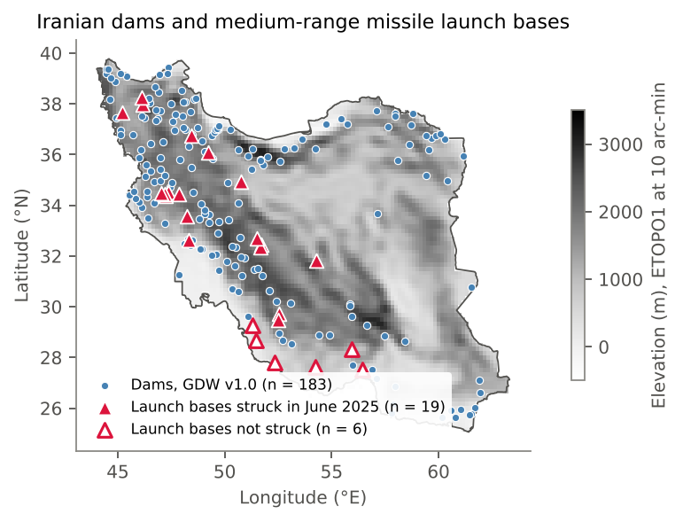

# A Statistical Assessment of "War May Answer Longtime Riddle of Iranian Dams Built for No Clear Reason"

*The New York Times*, 16 November 2026

Omid S. Solari, Ph.D. (Ph.D. in Statistics, University of California, Berkeley; sAIm Labs)

On 16 November 2026 *The New York Times* suggested that Iran's dams overlap geographically with the underground missile
sites struck by the United States and Israel, that Iran has an unusually large number of dams, and that the dams may have
been built to supply those sites. This site documents an open, reproducible test of each element of that argument.

**The data do not support the NYT article's claim.** Iran's missile bases are not unusually close to dams, military bases near water are the
norm worldwide, and Iran's dam numbers are not unusual for a water-scarce country.

[Read the full report (PDF)](report.pdf){ .md-button .md-button--primary }
[Source code on GitHub](https://github.com/osolari/iran-dams-colocation){ .md-button }

## Findings

| Claim in the NYT article | What the data show |
|---|---|
| Dams and missile sites overlap | **Rejected. Not significant against random locations in Iran (median 48.1 km, p = 0.146); after matching on terrain, towns and rivers the bases lie farther from dams than expected (p = 0.908).** The mean is shorter than random (p = 0.011) but not after matching. |
| The overlap is distinctive to military sites | **Rejected. Towns and airports show the same apparent overlap**; it reflects settlement geography. |
| Military siting near water is anomalous | **Rejected. Iran's launch bases rank 49th of 54 states for proximity to the nearest dam or coast; military sites in 91% of states lie closer to water.** Relative to each state's own geography: 29th for dams, 47th for dams or coast. |
| Iran has unusually many dams | **Rejected. Dam density of 3.3 per 10,000 km², below Spain (25.1), Turkey (11.9) and Morocco (6.7); construction peaks in 2015–2019, the same period as Turkey.** |

## Caveats

The NYT article's full text, Nima Shokri's map of 533 Iranian dams and the NYT article's strike map are not public. Global Dam Watch
(183 Iranian dams) and the Alma Research Center's list of 25 launch bases are used instead. See
[Data sources](sources.md) and the limitations section of the report.
