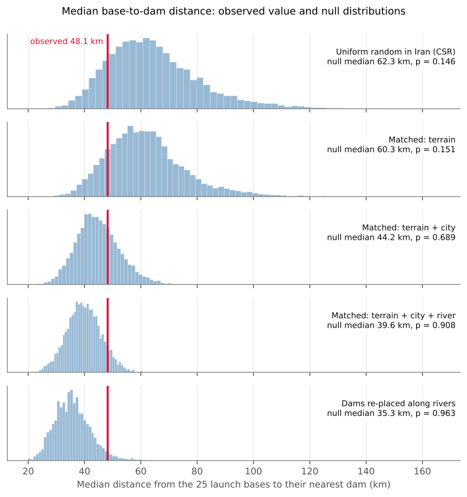
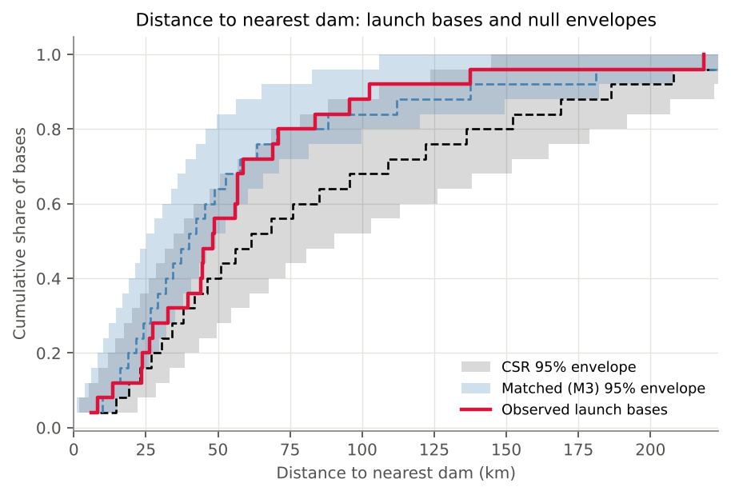
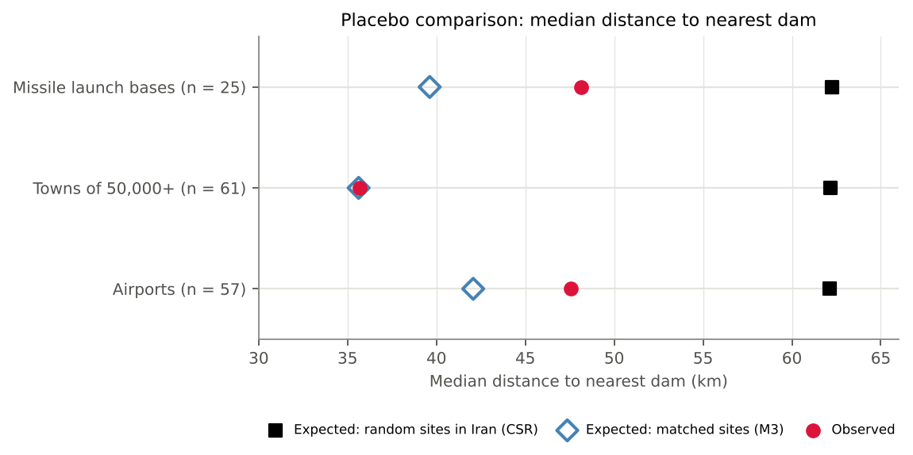
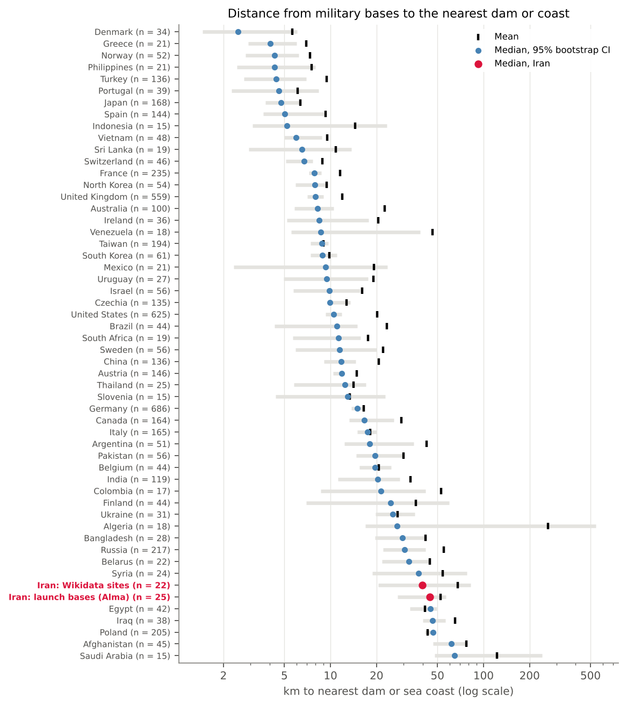
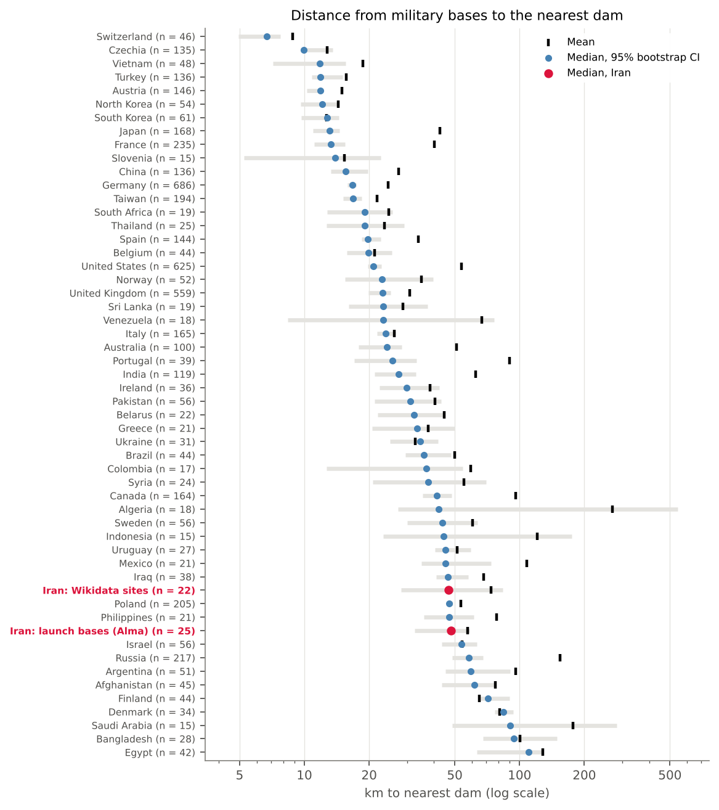
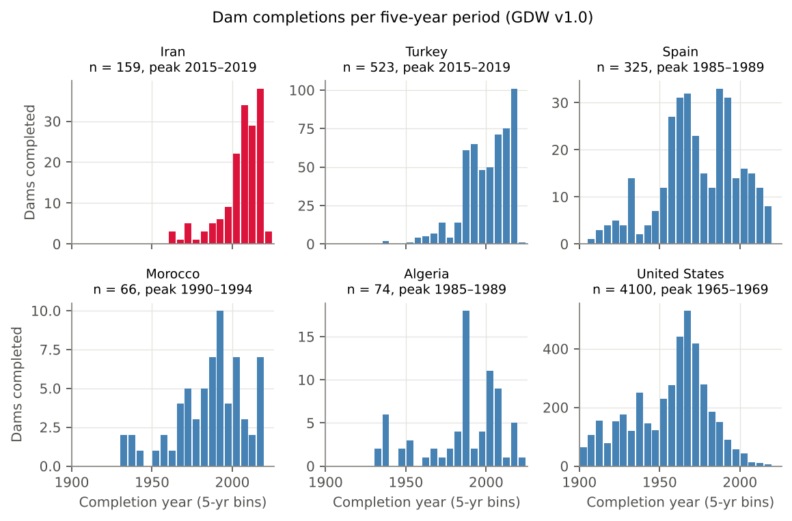
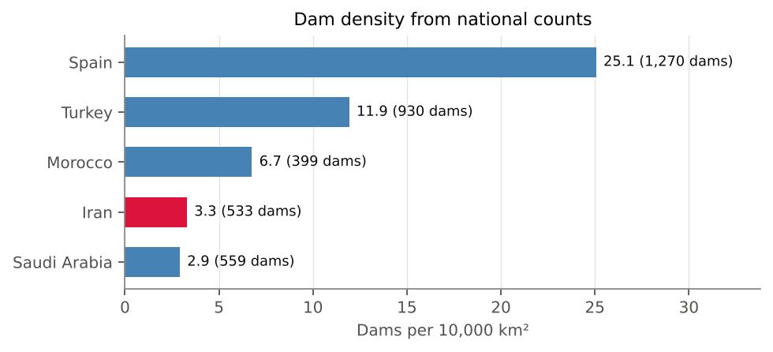

# Results

## 1. Co-location of launch bases and dams

Observed median distance from the 25 launch bases to their nearest dam: **48.1 km**
(mean 57.5 km; 8% within 10 km, 12% within 20 km).

| Null model | Expected median (km) | 95% range | Observed / expected | p (one-sided) |
|---|---|---|---|---|
| CSR | 62.3 | [38.7, 104.9] | 0.77 | 0.146 |
| M1 | 60.3 | [39.1, 97.1] | 0.80 | 0.151 |
| M2 | 44.2 | [31.0, 62.2] | 1.09 | 0.689 |
| M3 | 39.6 | [27.8, 52.5] | 1.21 | 0.908 |
| RIV | 35.3 | [24.8, 50.1] | 1.36 | 0.963 |

### Placebo sites

| Site set | n | Observed median (km) | p, random sites | p, matched sites |
|---|---|---|---|---|
| Missile launch bases | 25 | 48.1 | 0.146 | 0.908 |
| Towns of 50,000+ | 61 | 35.7 | < 0.001 | 0.506 |
| Airports | 57 | 47.6 | 0.052 | 0.856 |

### Robustness

- Large dams only (66): CSR p = 0.131; M3 p = 0.725.
- Struck in June 2025 against not attacked: medians 48.1 and 56.9 km, Mann–Whitney p = 0.30.
- Sensitivity to statistic and match size: `results/tables/iran_sensitivity.csv`.

## 2. Military installations and water worldwide

| Rank | State | n | Water median | Water mean | Dam median | Coast median | Ratio |
|---|---|---|---|---|---|---|---|
| 1 | Denmark | 34 | 2.5 | 5.6 | 84.4 | 2.5 | 0.32 |
| 2 | Greece | 21 | 4.1 | 7.0 | 33.5 | 5.7 | 0.35 |
| 3 | Norway | 52 | 4.3 | 7.4 | 23.0 | 4.9 | 0.39 |
| 4 | Philippines | 21 | 4.3 | 7.5 | 47.2 | 4.3 | 0.35 |
| 5 | Turkey | 136 | 4.4 | 9.4 | 11.9 | 5.2 | 0.26 |
| 6 | Portugal | 39 | 4.6 | 6.1 | 25.6 | 6.2 | 0.46 |
| 7 | Japan | 168 | 4.7 | 6.3 | 13.1 | 6.6 | 0.58 |
| 8 | Spain | 144 | 5.0 | 9.3 | 19.7 | 18.2 | 0.36 |
| 9 | Indonesia | 15 | 5.2 | 14.5 | 44.4 | 22.1 | 0.14 |
| 10 | Vietnam | 48 | 5.9 | 9.5 | 11.8 | 19.9 | 0.38 |
| 11 | Sri Lanka | 19 | 6.5 | 10.9 | 23.2 | 20.1 | 0.64 |
| 12 | Switzerland | 46 | 6.7 | 8.8 | 6.7 | 293.5 | 0.58 |
| 13 | France | 235 | 7.9 | 11.6 | 13.3 | 146.2 | 0.45 |
| 14 | North Korea | 54 | 7.9 | 9.5 | 12.1 | 37.2 | 0.68 |
| 15 | United Kingdom | 559 | 7.9 | 11.9 | 23.1 | 19.0 | 0.73 |
| 16 | Australia | 100 | 8.2 | 22.6 | 24.2 | 15.0 | 0.05 |
| 17 | Ireland | 36 | 8.4 | 20.6 | 29.9 | 10.0 | 0.47 |
| 18 | Venezuela | 18 | 8.6 | 46.5 | 23.2 | 78.6 | 0.09 |
| 19 | Taiwan | 194 | 8.8 | 9.0 | 16.8 | 14.0 | 0.73 |
| 20 | South Korea | 61 | 8.8 | 9.9 | 12.7 | 35.2 | 0.95 |
| 21 | Mexico | 21 | 9.3 | 19.3 | 45.3 | 9.3 | 0.27 |
| 22 | Uruguay | 27 | 9.4 | 19.1 | 45.2 | 15.0 | 0.42 |
| 23 | Israel | 56 | 9.9 | 16.1 | 53.6 | 14.8 | 0.34 |
| 24 | Czechia | 135 | 9.9 | 12.8 | 9.9 | 390.9 | 0.63 |
| 25 | United States of America | 625 | 10.5 | 20.2 | 20.9 | 140.5 | 0.39 |
| 26 | Brazil | 44 | 11.0 | 23.4 | 36.0 | 32.3 | 0.17 |
| 27 | South Africa | 19 | 11.3 | 17.6 | 19.0 | 226.0 | 0.52 |
| 28 | Sweden | 56 | 11.4 | 22.1 | 43.8 | 30.0 | 0.49 |
| 29 | China | 136 | 11.7 | 20.7 | 15.5 | 271.1 | 0.29 |
| 30 | Austria | 146 | 11.9 | 14.9 | 11.9 | 275.9 | 0.67 |
| 31 | Thailand | 25 | 12.4 | 14.1 | 19.0 | 142.7 | 0.60 |
| 32 | Slovenia | 15 | 13.0 | 13.4 | 13.9 | 99.2 | 0.82 |
| 33 | Germany | 686 | 15.0 | 16.5 | 16.7 | 274.4 | 0.83 |
| 34 | Canada | 164 | 16.6 | 29.1 | 41.3 | 234.3 | 0.23 |
| 35 | Italy | 165 | 17.4 | 18.2 | 23.9 | 47.2 | 1.33 |
| 36 | Argentina | 51 | 18.0 | 42.5 | 59.4 | 122.0 | 0.23 |
| 37 | Pakistan | 56 | 19.6 | 30.0 | 31.1 | 1013.9 | 0.27 |
| 38 | Belgium | 44 | 19.6 | 20.7 | 19.8 | 51.0 | 1.13 |
| 39 | India | 119 | 20.3 | 33.4 | 27.3 | 476.3 | 1.18 |
| 40 | Colombia | 17 | 21.4 | 52.8 | 37.0 | 281.1 | 0.17 |
| 41 | Finland | 44 | 24.7 | 36.2 | 71.5 | 52.8 | 0.61 |
| 42 | Ukraine | 31 | 25.6 | 27.4 | 34.6 | 408.4 | 0.74 |
| 43 | Algeria | 18 | 27.3 | 263.1 | 42.2 | 109.5 | 0.06 |
| 44 | Bangladesh | 28 | 29.4 | 42.0 | 93.8 | 42.4 | 0.61 |
| 45 | Russia | 217 | 30.4 | 55.0 | 58.0 | 185.3 | 0.20 |
| 46 | Belarus | 22 | 32.4 | 44.7 | 32.4 | 409.9 | 0.69 |
| 47 | Syria | 24 | 37.7 | 54.2 | 37.7 | 108.9 | 0.56 |
| 48 | **Iran** | 22 | 39.8 | 68.1 | 46.9 | 134.2 | 0.70 |
| 49 | **Iran: launch bases (Alma)** | 25 | 44.5 | 52.2 | 48.1 | 239.8 | 0.81 |
| 50 | Egypt | 42 | 44.9 | 41.5 | 110.2 | 52.8 | 0.30 |
| 51 | Iraq | 38 | 46.3 | 65.2 | 46.6 | 491.0 | 0.52 |
| 52 | Poland | 205 | 46.7 | 43.1 | 47.2 | 238.0 | 1.34 |
| 53 | Afghanistan | 45 | 61.8 | 77.2 | 61.8 | 779.5 | 0.53 |
| 54 | Saudi Arabia | 15 | 64.9 | 122.6 | 90.2 | 354.9 | 0.29 |

Distances in km. Water = nearest dam or sea coast. Ratio = median for military sites divided by median for random points
in the same state.

## 3. Dam construction under water scarcity

